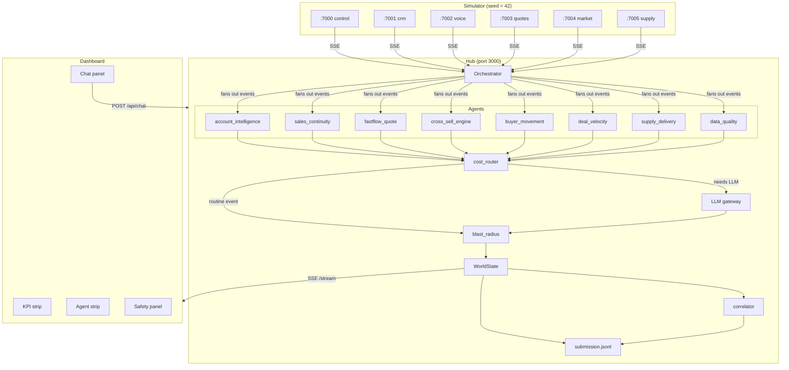

# SalesPulse Hub

My Stage A submission for the EEL challenge. Seven governed agents subscribe to the six simulator feeds, do real reasoning over live data, and write every decision to `submission.jsonl`. The dashboard is a live view of what the agents are doing — not a mock.

---

## Getting started

You'll need Python 3.11+ and two terminal windows.

```bash
# install both packages (only needed once)
cd sim     && pip install -e . && cd ..
cd starter && pip install -e . && cd ..

# set up your LLM key — copy the example and fill it in
cp starter/.env.example starter/.env
# open starter/.env and set LLM_API_KEY, LLM_BASE_URL, LLM_MODEL
# I used Groq (llama-3.3-70b-versatile) but any OpenAI-compatible endpoint works
# If you skip this the agents run in demo mode — all tests still pass

# terminal 1: start the simulator
cd sim && python3 server.py --instant
# --instant fires all 36 events ~4s after boot so you don't wait 2 hours

# terminal 2: start the hub
cd starter && python3 server.py

# open the dashboard
open http://localhost:3000
```

The run completes in under a minute in instant mode. `submission.jsonl` is written to `starter/submission.jsonl` as events are processed. Copy it to the project root when done:

```bash
cp starter/submission.jsonl submission.jsonl
```

### Not working?

```bash
python3 doctor.py
```

This checks Python version, whether the six ports are free, whether your LLM key is reachable, and prints the bundle version. Useful if the hub starts but agents aren't firing.

### Tests

```bash
cd sim     && python3 -m pytest -q   # 52 tests
cd starter && python3 -m pytest -q   # 79 tests
```

---

## How it's structured

```
EEL/
├── sim/                    # the simulator — don't touch this
│   ├── sim/feeds/          # six SSE feeds on ports 7000-7005
│   ├── sim/events.py       # the 36 seeded events (seed=42)
│   └── server.py
│
├── starter/                # my code lives here
│   ├── hub/
│   │   ├── agents/         # the seven agents + data_quality + correlator
│   │   ├── tools/
│   │   │   ├── cost_router.py      # decides which events actually need LLM
│   │   │   ├── blast_radius.py     # value/reach/reversible/external → low/med/high
│   │   │   └── llm_client.py       # thin async wrapper around OpenAI SDK
│   │   ├── store/world_state.py    # shared in-memory state
│   │   ├── dashboard/              # index.html + styles.css + app.js, no build step
│   │   └── main.py                 # FastAPI: dashboard, SSE stream, REST, chat
│   ├── tests/              # 79 tests
│   └── submission.jsonl    # written during each run
│
├── submission.jsonl        # copy for the grader
├── README.md
├── WRITEUP.md
└── doctor.py
```

---

## Architecture



Each event goes: **feed → orchestrator → agent → cost_router → (LLM?) → blast_radius → WorldState → submission.jsonl + dashboard**.

---

## Environment variables

| Variable | Example | Notes |
|---|---|---|
| `LLM_API_KEY` | `gsk_...` | Groq / OpenAI key |
| `LLM_BASE_URL` | `https://api.groq.com/openai/v1` | omit for OpenAI |
| `LLM_MODEL` | `llama-3.3-70b-versatile` | |
| `SIM_HOST` | `localhost` | change if sim is on another machine |
| `TOKEN_QUOTA` | `200000` | hard cap, default is plenty for a single run |

---

## Gotchas

- **Corporate proxy / Zscaler**: if `doctor.py` shows LLM unreachable the agents will fall back to demo stubs automatically. Everything still runs, just without real LLM responses.
- **Port conflicts**: if you get "address already in use" on 7000-7005 or 3000, run `lsof -ti:7000,7001,7002,7003,7004,7005,3000 | xargs kill -9` first.
- **macOS SSL**: Python on macOS doesn't pick up system certs automatically. If you hit SSL errors, run `pip install certifi` and make sure your `REQUESTS_CA_BUNDLE` points to it.
- **submission.jsonl line count varies slightly** between runs because the cross-sell engine fires on every account sync — the count depends on how many CRM ticks happen before the hub shuts down.

---

## Docker (optional)

The challenge is intentionally local-first so Docker isn't required, but if you want it:

```bash
docker compose up --build
```
